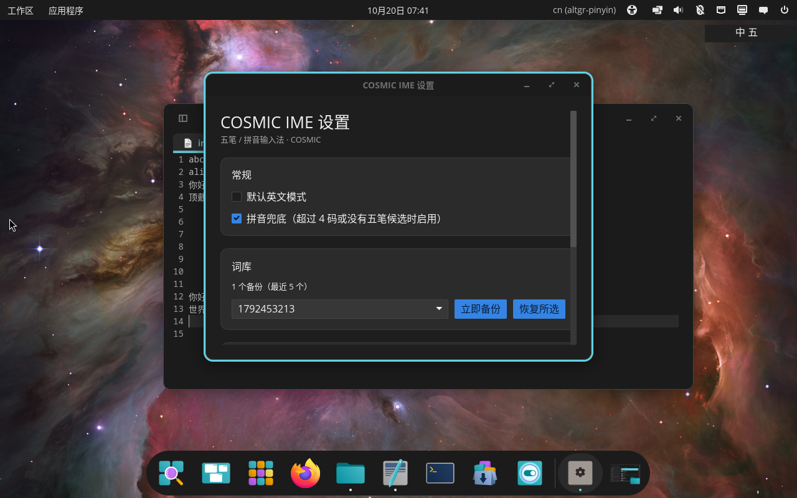
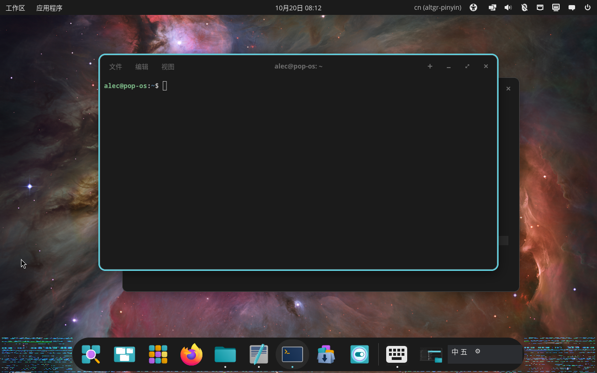

# RPCI IME

COSMIC 原生五笔/拼音输入法，基于 Wayland `zwp_input_method_v2` 与 RIME。

[](https://github.com/AllenZhang45/rpci/actions/workflows/ci.yml)
[](https://github.com/AllenZhang45/rpci/releases)

> 当前版本 `0.1.0`。这是个人使用的原型，不是通用发行版；安装前请先看[已知限制](#已知限制)。

## 特性

- COSMIC 1.10 / Wayland 原生输入法
- 五笔 86 优先，超过 4 码或无候选时自动转拼音
- 候选窗使用 `input_popup_surface`，2x 渲染、明暗主题、HIG 圆角
- 中英切换：Ctrl+Space
- 中文标点、Enter 换行、方向键/Ctrl 组合/功能键透传
- COSMIC 顶部 Panel（任务栏）Applet：只读显示 `中 五` / `中 拼` / `英`，不抢键盘焦点
- iced 设置窗口：候选数量、主题、词库备份/导出/导入
- XDG 配置/数据/缓存分离
- 签名 APT 仓库、`.deb`、GitHub Actions CI 与 Release

## 安装

### 方式一：Release `.deb`（推荐）

适用于 Ubuntu / Pop!_OS 24.04 amd64。

```bash
cd /tmp
curl -LO https://github.com/AllenZhang45/rpci/releases/download/v0.1.0/rpci-ime_0.1.0_amd64.deb
sudo apt install ./rpci-ime_0.1.0_amd64.deb
```

如果系统里之前用源码安装过，先移除用户级 autostart，避免两个实例：

```bash
rm -f ~/.config/autostart/rpci-ime.desktop
systemctl --user disable --now 'app-rpci\x2dime@autostart.service' 2>/dev/null || true
```

安装后重新登录，或启动输入法：

```bash
systemctl --user daemon-reload
systemctl --user start 'app-rpci\x2dime@autostart.service'
```

首次登录时 launcher 会准备 RIME schema，并把 applet 加入 COSMIC 顶部 Panel 的右侧状态区。

### 方式二：从源码安装（用户级）

需要 Rust stable（edition 2024）和以下系统依赖：

```bash
sudo apt update
sudo apt install -y \
  build-essential pkg-config libclang-dev \
  librime-dev librime-data \
  libwayland-dev wayland-protocols \
  libxkbcommon-dev libxkbcommon-x11-dev \
  libegl1-mesa-dev libgl1-mesa-dev libvulkan-dev \
  libfontconfig1-dev libfreetype-dev \
  libx11-dev libxrandr-dev libxi-dev libxcursor-dev \
  git
```

安装 Rust（如果还没有）：

```bash
curl --proto '=https' --tlsv1.2 -sSf https://sh.rustup.rs | sh
source "$HOME/.cargo/env"
```

克隆并安装：

```bash
git clone https://github.com/AllenZhang45/rpci.git
cd rpci
./prototype/scripts/install.sh
```

安装脚本会：

- 构建并安装到 `~/.local/bin`
- 准备 `~/.local/share/rpci/rime`
- 安装 systemd XDG autostart
- 安装设置菜单入口
- 把 applet 加入 COSMIC 顶部 Panel 的 `plugins_wings` 右侧状态区

启动：

```bash
systemctl --user daemon-reload
systemctl --user start 'app-rpci\x2dime@autostart.service'
```

如果提示找不到单元，注销再登录一次。

### 方式三：APT 仓库

公共 HTTPS APT 源尚在部署阶段，完成前请使用上面的 `.deb` 或源码安装。

部署流程见 [docs/APT-PAGES.md](docs/APT-PAGES.md)；本地签名仓库见 [docs/APT-REPO.md](docs/APT-REPO.md)。

## 首次使用

1. 打开任意 Wayland 文本应用（cosmic-edit、Chrome、VS Code 等）
2. 输入 `wqiy`，按空格，应上屏「你」
3. 按 Ctrl+Space 切换中英；顶部 Panel 中的 applet 应同步显示 `中 五` / `英`
4. 设置从应用菜单打开「COSMIC IME 设置」

设置也可以从应用菜单打开「COSMIC IME 设置」，或执行：

```bash
ime-settings-iced
```

兼容回退设置窗口：

```bash
ime-settings-gui
```

## 验证安装

```bash
systemctl --user status 'app-rpci\x2dime@autostart.service'
pgrep -a ime-probe
cat /run/user/$(id -u)/rpci/state
```

`state` 应显示 `中 五` 或 `英`。

## 卸载

源码安装：

```bash
./prototype/scripts/uninstall.sh
# 连同配置和 RIME 用户数据一起删除：
./prototype/scripts/uninstall.sh --purge
```

包安装：

```bash
sudo apt remove rpci-ime
```

用户数据默认保留：

```
~/.config/rpci/
~/.local/share/rpci/
~/.cache/rpci/
```

## 截图






## 应用兼容性

| 应用 | 状态 |
|---|---|
| cosmic-edit、LibreOffice | ✅ |
| Google Chrome / VS Code | ✅（Wayland IME 已启用） |
| GNOME Text Editor（Flatpak） | ✅ |
| Qt6 6.4.2 | ❌ 上游只支持 text-input v1/v2 |
| Firefox | ❌ 当前 COSMIC 下收不到 `Activate` |
| XWayland / xterm | ❌ 没有 XIM 服务端 |

详细矩阵：[docs/APP-MATRIX.md](docs/APP-MATRIX.md)。

## 构建与测试

```bash
cargo fmt --all --check
cargo test -p ime-probe
cargo test -p rpci-settings-iced

./prototype/packaging/build-deb.sh
./prototype/packaging/test-deb.sh
./prototype/packaging/test-repo.sh
```

完整 CI 本地复现：

```bash
./prototype/scripts/ci.sh
```

## 已知限制

- Qt6 6.4.2 缺少 `zwp_text_input_v3` 支持，详见 [docs/QT6-AUDIT.md](docs/QT6-AUDIT.md)
- Firefox 在当前 COSMIC 版本下没有发送 `Activate`，详见 [docs/FIREFOX.md](docs/FIREFOX.md)
- XWayland 需要 XIM，当前不支持，详见 [docs/XWAYLAND-AUDIT.md](docs/XWAYLAND-AUDIT.md)
- Panel applet 尚无 AccessKit/AT-SPI 屏幕阅读器支持
- 公共 HTTPS APT 源尚未部署
- 仅 amd64

## 文档

- [更新日志](CHANGELOG.md)
- [文档索引](docs/README.md)
- [当前状态](docs/STATUS.md)
- [路线图](docs/ROADMAP.md)
- [架构](docs/ARCHITECTURE.md)
- [协议审计](docs/PROTOCOL-AUDIT.md)
- [XDG 审计](docs/XDG-AUDIT.md)
- [设置界面](docs/SETTINGS-GUI.md)
- [打包](docs/PACKAGING.md)
- [APT 仓库](docs/APT-REPO.md)
- [CI](docs/CI.md)
- [DSH Skills](docs/SKILLS.md)
