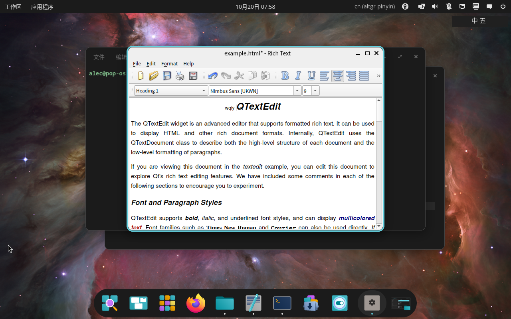
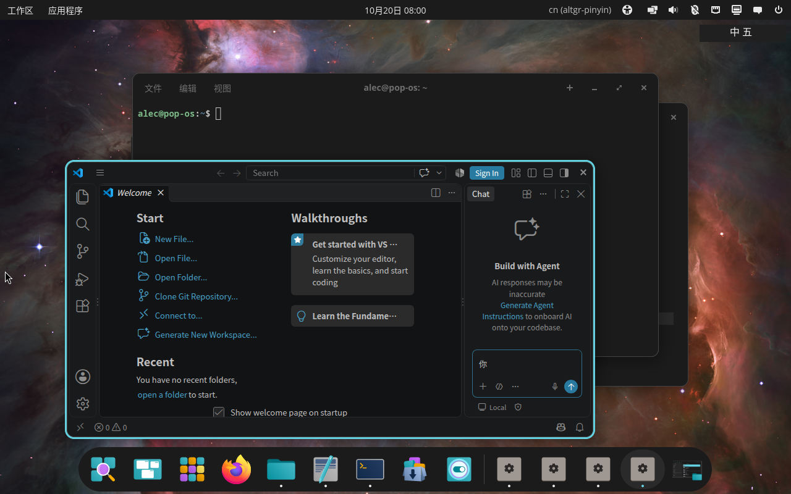
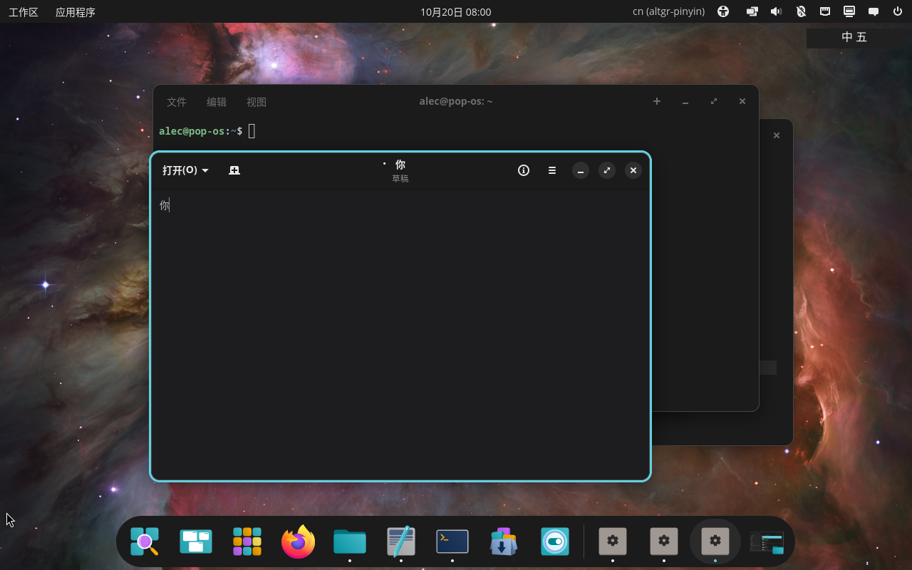

# 应用矩阵

> 状态：2026-10-20。原型阶段的应用兼容性记录，按 [PRINCIPLES.md](PRINCIPLES.md) 第 4 条执行。

## 结论

- **通过**：合成 `zwp_text_input_v3` 客户端、cosmic-edit、LibreOffice Writer、VS Code（Electron）、GNOME Text Editor（Flatpak）。
- **应用侧问题**：cosmic-term 能激活输入法，但提交没有写入 PTY。
- **Qt6 问题**：Qt 6.4.2 的 `textedit` / `lineedits` 示例没有发送 `Activate`，按键直接进入应用。
- **上游问题**：Firefox 158、XWayland 下的 xterm 390 都没有收到 `Activate`，输入法无法接管。
- **未测**：独立 Chromium 浏览器。

## 矩阵

| 应用 | 版本 | 工具链 | 会话 | 激活 | 提交 | 备注 |
|---|---|---|---|---|---|---|
| 合成 text-input 客户端 | 本仓库 | SCTK | Wayland | ✅ | ✅ | 收到 `COMMIT "你"` |
| cosmic-edit | 1.10.0 | libcosmic | Wayland | ✅ | ✅ | Ctrl+S 后文件为 `你` |
| LibreOffice Writer | 24.2.7 | GTK3 | Wayland | ✅ | ✅ | ODT `content.xml` 含 `你` |
| cosmic-term | 1.10.0 | libcosmic | Wayland | ✅ | ⚠️ | 提交未进 PTY |
| Firefox | 158.0 | Gecko | Wayland | ❌ | — | 未收到 `Activate`，见 [FIREFOX.md](FIREFOX.md) |
| xterm | 390 | X11 / XWayland | XWayland | ❌ | — | 需要 XIM，当前不支持 |
| Qt6 textedit/lineedits | 6.4.2 | Qt6 / QtWayland | Wayland | ❌ | — | 客户端只支持 v1/v2，不支持 text-input-v3；见 [QT6-AUDIT.md](QT6-AUDIT.md) |
| VS Code | 1.142.0 | Electron/Chromium | Wayland | ✅ | ✅ | Wubi 提交进聊天输入框 |
| GNOME Text Editor | 51.0 | GTK4 / Flatpak | Wayland | ✅ | ✅ | 提交「你」，收到 surrounding text |
| 独立 Chromium | — | Chromium | — | 未测 | — | 环境未安装浏览器 |

## 说明

### cosmic-term

输入法能激活并收到按键，但 `commit_string` 没有写入终端 PTY。判断为终端自身的 IME 提交处理问题，记录为应用侧差异；后续可尝试升级 cosmic-term 或给它报 issue。

### Firefox

Firefox 158 已确认走 Wayland（加载 `libwayland-client`），但窗口/页面聚焦后没有 `Activate`。COSMIC 只暴露 `zwp_text_input_manager_v3` v1，疑似 Firefox 需要更新的 text-input 实现。详见 [FIREFOX.md](FIREFOX.md)。

### XWayland

xterm 390 通过 XWayland 运行。COSMIC 没有向输入法发送 `Activate`；虚拟键盘注入也没有观察到写入 xterm 的 `cat` 目标。X11 应用通常需要 XIM，而本项目当前只实现 Wayland 输入法协议，因此 XWayland 暂不支持。

### Qt6

用 `qt6-base-examples` 的 `textedit` 与 `lineedits` 测试：

- 窗口以 Wayland 运行，app_id 为 `textedit` / `lineedits`。
- 聚焦后输入法没有收到 `Activate`；`wqiy` 被原样插入文本。
- 需要排查 QtWayland 6.4.2 的 text-input-v3 集成；当前记为 **失败**。
- 已定位：Qt 6.4.2 只识别 `zwp_text_input_v1/v2`，强制 v3 时日志为
  `text input: unknown protocol - "zwp_text_input_v3"`，因此退回
  `QComposeInputContext`。详见 [QT6-AUDIT.md](QT6-AUDIT.md)。



### Electron / VS Code

VS Code 1.142.0，使用：

```
--ozone-platform=wayland --enable-wayland-ime --no-sandbox
```

- 输入法收到 `Activate`。
- `wqiy` + space 提交「你」到聊天输入框。
- 说明 Electron/Chromium 系应用在启用 Wayland IME 后可用。



### Flatpak

安装 `org.gnome.TextEditor` 51.0（Flathub）：

- 输入法收到 `Activate`。
- 提交「你」，并收到 `SurroundingText` / `ContentType`。
- Flatpak 沙箱不会阻断 Wayland text-input。



## 复现方法

- 合成客户端：`cargo run -p ime-probe --bin textinput`
- cosmic-edit：打开文件，输入 `wqiy` + 空格，再 Ctrl+S
- LibreOffice：打开 ODT，输入后 Ctrl+S，解压 `content.xml` 检查
- Firefox：`prototype/scripts/firefox-test-server.py` + `MOZ_ENABLE_WAYLAND=1 firefox`
- XWayland：`DISPLAY=:1 xterm -e 'cat > /tmp/xterm-ime.txt'`

## 后续

1. 排查 Qt6 6.4.2 / QtWayland text-input 不激活的问题。
2. 找独立 Chromium 浏览器补充矩阵。
3. XWayland 若要支持，需要单独设计 XIM 或 X11 输入法路径，不在当前 Wayland 原型范围内。
4. Firefox 等上游 text-input 支持，详见 [FIREFOX.md](FIREFOX.md)。
