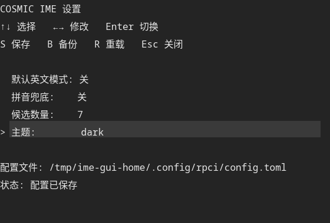

# 设置界面

> 状态：2026-10-20。对应 [ROADMAP.md](ROADMAP.md) 的“设置界面收尾”。

主入口是 iced 0.14 窗口 `rpci-settings-iced`；另保留自绘 SCTK 窗口 `ime-settings-gui` 作为无 GPU 环境的回退。


## 启动

安装后应用菜单会出现 **COSMIC IME 设置**：

```bash
./prototype/scripts/install.sh
```

也可以直接运行：

```bash
cargo run -p rpci-settings-iced
# 安装后
~/.local/bin/ime-settings-iced
```

兼容回退：

```bash
./target/debug/ime-settings-gui
# 安装后：~/.local/bin/ime-settings-gui
```

启动器：

```
~/.local/share/applications/rpci-settings.desktop
~/.local/share/applications/rpci-settings-fallback.desktop
```

## iced 主入口

覆盖：

| 项目 | 说明 |
|---|---|
| 默认英文模式 | `ascii_mode_default` |
| 拼音兜底 | `pinyin_fallback` |
| 候选数量 | `candidate_count` 1–9 |
| 主题 | `theme` auto/dark/light |
| 保存 | 写入 `$XDG_CONFIG_HOME/rpci/config.toml` |
| 保存并应用 | 保存后通过 systemd 重启输入法 |
| 备份词库 | 立即创建备份，保留最近 5 份 |
| 恢复所选 | 从备份列表恢复，自动备份当前状态并重启输入法 |

窗口内容可滚动，避免小窗口下按钮被裁掉。

### 词库恢复流程

1. 在“词库”卡片选择备份（时间戳目录）。
2. 点击“恢复所选”。
3. 设置窗口先停止 systemd 输入法单元，避免 LevelDB 写入冲突。
4. `import_from` 恢复备份；恢复前会自动备份当前词库。
5. 重新启动输入法，状态栏显示结果。

如果 systemd 单元不存在，恢复仍会执行，但需要手动重启输入法。

## 兼容回退：SCTK

键盘操作：

| 按键 | 作用 |
|---|---|
| ↑ / ↓ | 选择设置项 |
| ← / → | 修改当前值 |
| Enter | 切换当前值 |
| S | 保存 |
| B | 立即备份 |
| R | 重载配置 |
| Esc | 关闭 |



回退窗口只覆盖配置和备份，没有恢复列表；恢复请用 iced 主入口或 CLI。

## CLI

```bash
ime-settings show
ime-settings set candidate_count 5
ime-settings set theme light
ime-settings apply          # 保存并重启输入法
ime-settings backup
ime-settings backups
ime-settings import <dir>
ime-settings export <dir>
```

## 验证

```
cargo test -p ime-probe
35 passed

cargo test -p rpci-settings-iced
3 passed
```

已验证：

- iced 窗口实际启动，词库卡片可见，备份列表显示时间戳
- 配置修改写入 `config.toml`
- `ime-settings apply` 实测会更换输入法 PID
- 备份/导入的底层逻辑由 `backup` 模块测试覆盖
- 已用等价 CLI 流程验证恢复：停止单元 → `ime-settings import <backup>` → 启动单元 → 输入「你」
- GUI“恢复所选”调用同一 `import_from` + stop/start 逻辑

未验证：

- 通过鼠标实际点击“恢复所选”完成一次恢复（UI 逻辑已接好）
- 恢复后重启失败时的完整回滚演练

## 限制

- 没有配置热加载；“保存并应用”通过 systemd 重启。
- 恢复依赖 systemd 单元；没有单元时需要手动重启。
- iced 窗口是普通 xdg_toplevel，不是 libcosmic 控件。
- SCTK 回退只支持键盘，且没有恢复 UI。
- 备份时仍建议先停止输入法；GUI 恢复会自动 stop/start。

## 后续

- 增加配置热加载。
- 增加恢复确认对话框和失败回滚提示。
- 评估 libcosmic 迁移。
