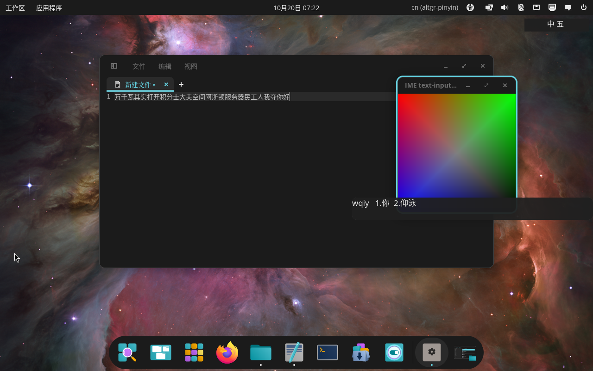

# UI 与 HIG 审计

> 日期：2026-10-20。对应 [ADR 0004](adr/0004-three-layer.md) 第三层。

## 设置界面：iced

新增独立 crate `settings-iced`（包名 `rpci-settings-iced`），使用 iced 0.14：

- 普通 xdg_toplevel 窗口，标题 `COSMIC IME 设置`
- 控件：checkbox、slider、pick_list、button、card 容器
- 覆盖：默认英文、拼音兜底、候选数量、主题、词库备份与恢复、重新加载
- 保存写入 `$XDG_CONFIG_HOME/rpci/config.toml`
- 深色 COSMIC 风格调色板：`#1e1e1e` 背景、`#2b2b2b` 卡片、`#3584e4` 主色、12px 圆角
- 安装为应用菜单主入口 `COSMIC IME 设置`

验证：

```bash
cargo test -p rpci-settings-iced
```

- `ThemeChoice` ↔ `ThemePreference` 往返测试
- `update` 修改配置字段测试
- 窗口实际启动，`focus` 能看到标题 `COSMIC IME 设置` 且状态为 Activated

未使用 libcosmic：当前 libcosmic v0.12 以 git submodule 形式携带 iced fork，构建链更重；iced 0.14 已满足“Rust + iced + COSMIC 风格”的要求。后续若需要完全继承 COSMIC 控件，再评估 libcosmic 版本。

## 候选窗：协议约束

候选窗**不能**直接用 iced/libcosmic 的普通窗口实现：

- 正确角色是 `zwp_input_popup_surface_v2`，由 `zwp_input_method_v2` 创建。
- iced 的窗口后端只创建 xdg_toplevel/xdg_popup，不能把已有 `wl_surface` 注入为 input-popup-surface。
- 改成普通窗口会破坏协议合规性、光标定位和焦点行为。

因此候选窗保留自绘 `wl_shm` 表面，但视觉按 COSMIC HIG 调整：

| 项目 | 调整 |
|---|---|
| 背景 | 深色 `#1e1e1e`，浅色 `#fafafa`，带 alpha |
| 圆角 | 10 逻辑像素（2x 渲染时 20px） |
| 字体 | Sans Serif，17 逻辑像素 |
| 间距 | 左右 12 逻辑像素 |
| 缩放 | 固定 2x buffer scale |


### 候选窗不显示修复（2026-10-20）

用户反馈候选窗不显示。实际根因不是圆角/配色，而是 buffer 生命周期：

- 初始化时 `attach` 了 buffer，但后续 `PopupRenderer::draw` 只写 mmap + `damage` + `commit`，没有重新 `attach`。
- COSMIC 不会在只 damage 的情况下重新读取同一块 shm 内容，候选窗一直停留在初始化时的透明帧。
- 修复：每次 draw 都 `attach(buffer)` + `damage_buffer` + `commit`；并把 `set_buffer_scale(2)` 移到首次 attach 之前。
- 实测：release 输入法在测试窗口中显示 `wqiy 1.你 2.仰泳`，见下方屏幕截图。



边界：

- 未实现屏幕边缘翻转验证。
- 未接 `wp_fractional_scale_v1`，固定 2x。
- 未实现选中项高亮（RIME 当前输出没有选中索引）。
- 候选窗仍是自绘，不是 iced widget；这是协议角色决定的，不是遗漏。

## HIG 对照

| HIG 关注点 | 当前状态 |
|---|---|
| 深/浅主题 | 支持，读 COSMIC `is_dark` + 配置 |
| 圆角/表面 | 候选窗已加 10px 圆角；设置卡片 12px |
| 间距 | 候选窗 12px；设置 24px 外边距、18px 卡片内边距 |
| 字体 | 候选窗 Sans；设置使用 iced 默认字体 |
| 主色/强调色 | 设置 `#3584e4`；候选窗暂未使用强调色 |
| 键盘可达性 | 设置窗口支持 Tab/方向键/Enter（iced 默认）；候选窗只读 |
| 多显示器/缩放 | 候选窗固定 2x；未验证 fractional scale |
| 焦点 | 候选窗不抢焦点；设置窗口普通焦点 |

## 待验证

1. 在真实 COSMIC 会话中目视检查 iced 设置的字体、间距、窗口装饰。
2. 用 COSMIC 截图工具记录 iced 窗口；本次 portal 截图没有产出文件，因此文档中只记录启动验证。
3. 候选窗在屏幕底部/右侧的边缘翻转。
4. `cosmic-osk` 与第三方输入法的键盘焦点竞争。
