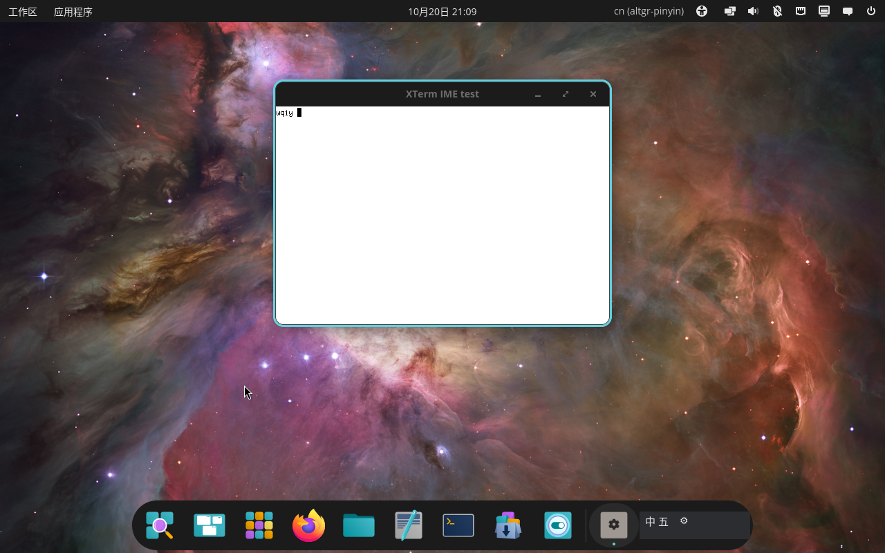

# XWayland / XIM 评估

> 日期：2026-10-20。结论：当前 COSMIC 会话没有 XIM 服务端；本 IME 无法服务 XWayland 应用，且不建议在本项目内实现 XIM。

## 环境

- COSMIC 1.10
- Xwayland 24.1.13，`DISPLAY=:1`
- xterm 390
- IME 仅实现 Wayland `zwp_input_method_v2`

## 证据

### 1. 没有 XIM 服务端

```bash
DISPLAY=:1 xprop -root _XIM_SERVERS
```

结果：

```
_XIM_SERVERS:  no such atom on any window.
```

X11 的 XIM 客户端通过根窗口的 `_XIM_SERVERS` 选择输入法服务；该属性不存在，说明没有 XIM 服务注册。

```bash
DISPLAY=:1 xlsatoms | grep -i xim
```

没有 `_XIM_SERVERS` 或 XIM 相关 atom。

### 2. xterm 实际输入

在 XWayland 下运行：

```bash
DISPLAY=:1 XMODIFIERS=@im=none \
  xterm -title 'XTerm IME test' -e 'cat > /tmp/xterm-ime.txt'
```

聚焦窗口，通过虚拟键盘输入 `wqiy`：

- xterm 中原样出现 `wqiy`
- IME 日志没有 `Activate`
- 没有中文提交



### 3. 协议层不匹配

- XWayland 应用使用 X11 输入模型，中文输入依赖 XIM
- 当前 IME 只实现 Wayland input-method-v2
- Xwayland 不会把 XIM 请求转发给 Wayland input-method
- COSMIC 也没有向 XWayland 提供 XIM 服务端

## 结论

**当前不支持 XWayland 中文输入。**

不是 IME 的 `Activate` 处理 bug，而是缺少整条 XIM 服务端链路。

## 可行方向

1. **推荐：使用应用的 Wayland 版本**（Chrome、VS Code、GTK4 等已验证）
2. 需要 X11 应用时，单独运行 fcitx5/ibus 等 XIM 服务端；与本项目无关
3. 在 COSMIC/Xwayland 上游实现 XIM → Wayland input-method 桥接
4. 在本项目内实现 XIM 服务端：需要 Xlib/XCB、XIM 协议、编码、焦点和预编辑，工作量与现有 Wayland IME 相当，不建议

## 决策

- 不实现 XIM
- 在 [APP-MATRIX.md](APP-MATRIX.md) 和 [STATUS.md](STATUS.md) 中记录为不支持
- XWayland 用户改用 Wayland 应用或独立的 XIM 输入法
